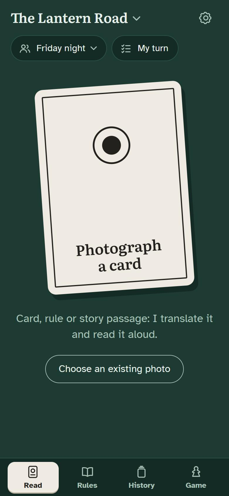
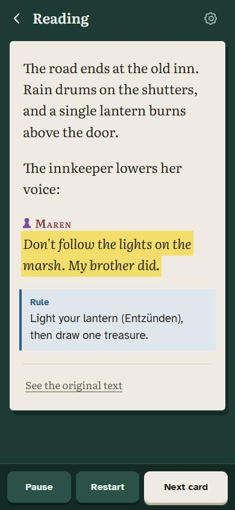
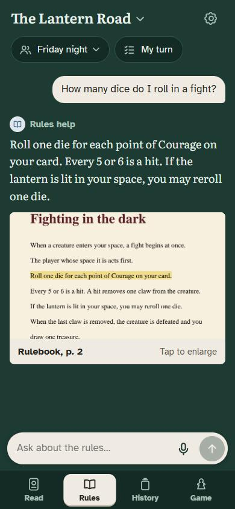
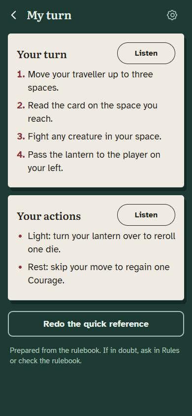

# Board Game Narrator

*[Version française](README.fr.md)*

Take a photo of a card, rule or story passage from a board game. The app translates it and reads it aloud, with a different voice for each character. It also answers rules questions from the game's own rulebook, in writing or in a live voice conversation.

| Photograph a card | Listen to it | Ask about the rules | See what to do |
|:---:|:---:|:---:|:---:|
|  |  |  |  |

The interface, translations and voices are available in **English** and **French** (Settings → Language). Cards can be in any language.

It is a web app made for the phone. It runs on your own computer or [server](docs/DEPLOY.md): Claude reads and translates, through [Claude Code](https://claude.com/claude-code) (your Claude plan) or the Anthropic API (your key), and [ElevenLabs](https://elevenlabs.io) provides the voices.

## Features

- **Read a card:** photo, crop, translation, then narration with a voice per character and an optional soundscape.
- **Game profiles:** each game keeps its glossary, rulebook, groups of players, sessions and character voices.
- **Rules help:** chat answers based on the rulebook you add (PDF or photos), with a picture of the page and the passage highlighted.
- **Voice chat:** real-time conversation you can interrupt by speaking.
- **My turn:** a one-page quick reference drawn from the rulebook.
- **Costs:** Settings shows what cards, questions and voices used, evening by evening.
- **History and "Previously…":** replay past cards, or hear a recap of the last session.

## Requirements

- Node.js 22 or newer
- Claude, either way:
  - [Claude Code](https://claude.com/claude-code), signed in (`claude auth login`), the default
  - or an [Anthropic API key](https://platform.claude.com)
- An ElevenLabs API key. The French default voices come from the voice library and need a paid plan; the English ones are premade voices.
- For the home setup, [Tailscale](https://tailscale.com) (or another private HTTPS route) to open the app on a phone. The microphone needs HTTPS.

## Setup

```
npm install
```

Copy `.env.example` to `.env.local` and put your ElevenLabs key in it. To use the Anthropic API instead of Claude Code, also set:

```
CLAUDE_MODE=api
ANTHROPIC_API_KEY=your-key
```

A key alone changes nothing: the API is used only with `CLAUDE_MODE=api`. Restart the server after a change. API use is billed per token; the rulebook is prompt-cached to make follow-up questions cheaper.

Then:

```
npm start
```

Open `http://localhost:5173`. For your phone, share it on your own tailnet only:

```
tailscale serve --bg 5173
```

Open the address it prints in Safari or Chrome, then add it to the home screen.

On Windows, `scripts\installer-demarrage.ps1` installs a scheduled task that starts the server when you sign in.

### Or deploy on a server

No Tailscale or home computer needed: with Docker, a domain name and a shared password, see **[docs/DEPLOY.md](docs/DEPLOY.md)**.

## Security and costs

- In the home setup above, the server has **no login**: it listens on `127.0.0.1` only. Don't expose it to the Internet (no Tailscale Funnel, no port forwarding) without `APP_PASSWORD`.
- Everyone with access spends your Claude and ElevenLabs quota or API credit.
- API keys stay on the server. For voice chat, the phone gets single-use tokens only.
- Games, photos of rulebook pages, PDFs and cached audio are stored in `data/` and are never committed. Rulebooks are copyrighted: add your own.

## Development

```
npm test
```

To check rules answers against the real Claude (two requests per question, on your plan or key):

```
npm run evaluer -- --demo
```

Use a game's id instead of `--demo` to test your own game. Questions come from "Wrong answer?" under an answer and are kept in `data/evaluations`.

What's next: [ROADMAP.md](ROADMAP.md)

No build step: plain ES modules in `js/` (page) and `server/` (Node). Code and comments are in French; English texts are in `js/en.js`, keyed by the French text, and English instructions for Claude are in `server/prompts-en.mjs` and `js/claude.js`.

This is an independent project, not affiliated with Anthropic, ElevenLabs or any game publisher.

## License

[MIT](LICENSE)
